## Motivation {.section-slide background-color="#2d5fb2"}


## Background Modelling Problem
<!-- SVG states extracted from the corresponding overlays in 2026-wustl-gss.pdf. -->

```{=html}
<div class="r-stack beamer-artwork">
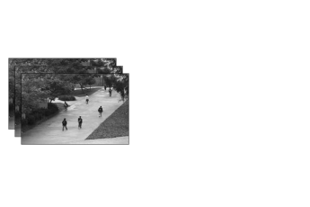
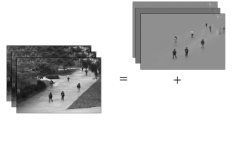
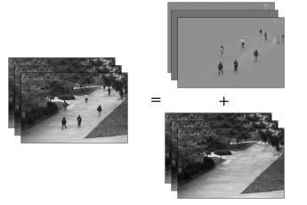
</div>
```


## Background Modelling Problem
<!-- SVG states extracted from the corresponding overlays in 2026-wustl-gss.pdf. -->

```{=html}
<div class="r-stack beamer-artwork">
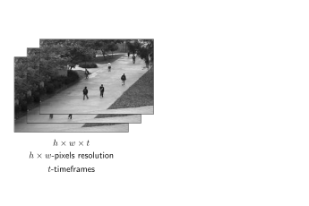
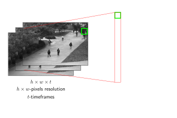
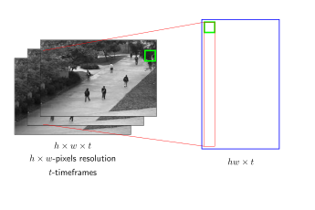
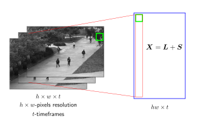
</div>
```


## Real-world applications
1.  A retail store uses user surveillance footage to analyze foot traffic patterns:

    - Optimize store layout and product.

    - Manage staff allocation.

    - Enhance security and loss prevention.

2.  Surveillance in airports, railways, traffic intersections, ATMs for crowd monitoring.

    - Improve operational efficiency of traffic hubs.

    - Ensure public safety through incident detection.

3.  Video filters (Zoom, Google meet).

4.  Motion detectors.


## Robust Background Modelling

:::::: {.fixed-steps}

- Singular Value Decomposition (SVD) can be used to estimate $\boldsymbol{L}$.
- Advantages compared to deep learning:
  1. Unsupervised. Needs no training data.
  2. Low hardware requirements.
  3. Generalizable.
  4. Better theoretical guarantees.

::::: {.nuisance-panel}
:::: {.columns}
::: {.column width="58%"}

[Real-life surveillance has many nuisances.]{.fragment .dim-until-shown data-fragment-index="0"}

```{=html}
<ol>
<li class="fragment dim-until-shown" data-fragment-index="0">Weather conditions (fog / rain)</li>
<li class="fragment dim-until-shown" data-fragment-index="1">Naturally moving background</li>
<li class="fragment dim-until-shown" data-fragment-index="2">Camera tampering</li>
</ol>
```

:::
::: {.column width="40%"}

```{=html}
<div class="r-stack nuisance-images">
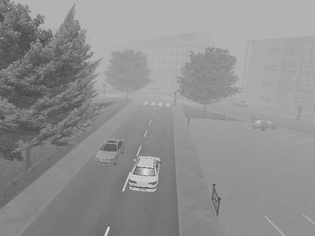
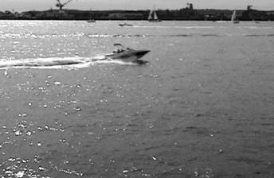

</div>
```

:::
::::
:::::

::::::


## Recommender Systems: MovieLens Data
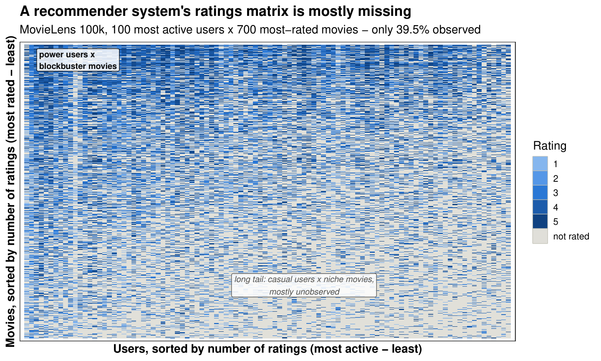{.nostretch .movielens-matrix}

The objective is then to [robustly]{.alert} estimate the latent factors (including the number of factors) and complete this matrix.


## Recommender Systems: Shilling Attacks
- Recommendation systems are widely used in e-commerce platforms to recommend products to users.

- Collected data includes (user, item) pairs and corresponding ratings.

- Underlying factors reveal the preferences of users and the characteristics of items.


::: {.fragment data-fragment-index="0"}

{width="49%"} {width="49%"}

:::


## Looking closely! What needs to change? {.section-slide background-color="#2d5fb2"}


## Singular Value Decomposition (SVD)
::: {.theorem}
For a $n \times p$ matrix $\boldsymbol{M}$, its singular value decomposition is defined by the factorization 

$$
\boldsymbol{M} = \boldsymbol{U}_{n \times r} \boldsymbol{D}_{r \times r} (\boldsymbol{V}_{p \times r})^\top
$$

 where,

1.  $\boldsymbol{U}, \boldsymbol{V}$ are unitary matrices (left and right singular vectors).

2.  $\boldsymbol{D}$ is a diagonal matrix comprising singular values, in decreasing order of magnitude.

3.  $r$ is the rank of the matrix
:::


## Is SVD / PCA really bad with outliers?
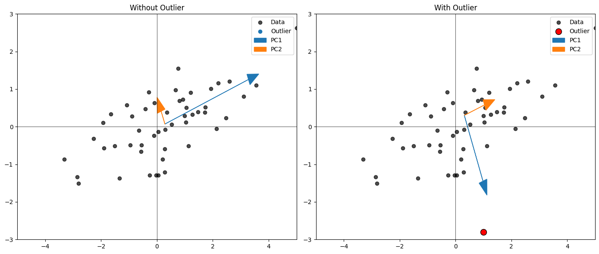{width="100%"}


## SVD as alternating regression

:::::: {.fixed-steps}

$$
\boldsymbol{X} = \boldsymbol{L} + \boldsymbol{S} + \boldsymbol{N}; \ \boldsymbol{L} \text{ low-rank}, \boldsymbol{S} \text{ sparse and } \boldsymbol{N} \text{ dense noise}
$$

::: {.fragment .dim-until-shown data-fragment-index="0"}

$$
\Rightarrow \quad
 \boldsymbol{X} = \boldsymbol{L} + \boldsymbol{E}, \text{ where, } \boldsymbol{E} = ((\epsilon_{ij}))_{i,j}; \ \epsilon_{ij} \sim (1-\delta) g + \delta h
$$

:::

::: {.fragment .dim-until-shown data-fragment-index="1"}

$$
\Rightarrow \quad
 X_{ij} = \sum_{k=1}^{r} \lambda_k u_{ki} v_{kj} + \epsilon_{ij}, \ \lambda_k = \text{ singular value, } u_{ki}, v_{kj} \text{ are singular vec. }
$$

:::

::: {.fragment .dim-until-shown data-fragment-index="2"}

$$
\Rightarrow \quad
 X_{ij} = \sum_{k=1}^{r} a_{ki} b_{kj} + \epsilon_{ij};
\ \text{assume, } a_{ki} = \sqrt{\lambda_k} u_{ki}, b_{kj} = \sqrt{\lambda_k} v_{kj}
$$

:::

::: {.fragment .dim-until-shown data-fragment-index="3"}

Fixing $j$ yields, 

$$
\begin{bmatrix}
X_{1j}\\
X_{2j}\\
\vdots\\
X_{nj}
\end{bmatrix} =
\begin{bmatrix}
a_{11} & \dots & a_{r1}\\
\vdots & \ddots & \vdots\\
a_{1n} & \dots & a_{rn}
\end{bmatrix}_{n \times r}
\begin{bmatrix}
b_{1j}\\
b_{2j}\\
\vdots\\
b_{rj}
\end{bmatrix} +
\begin{bmatrix}
\epsilon_{1j}\\
\epsilon_{2j}\\
\vdots \\
\epsilon_{nj}
\end{bmatrix}
$$

:::

::::::


## Classical SVD as the Iterative Regression
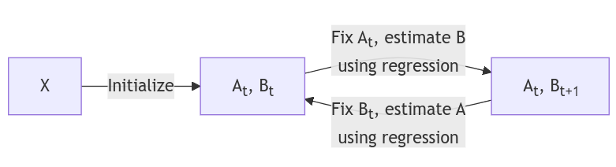{width="100%"}

1.  Assume that rank $r$ is known.

2.  Initialize $\boldsymbol{A}_0 = \boldsymbol{A}$ and $\boldsymbol{B}_0 = \boldsymbol{B}$ using classical SVD (or random orthogonal matrices, scaled by the singular values).

3.  Given $A_{t}$, estimate $B_{t+1}$ by solving $p$ multiple linear regression problems.

4.  Given $B_{t+1}$, estimate $A_{t+1}$ by solving $n$ multiple linear regression problems.

5.  Repeat until convergence.


## Geometry of Robust Statistics
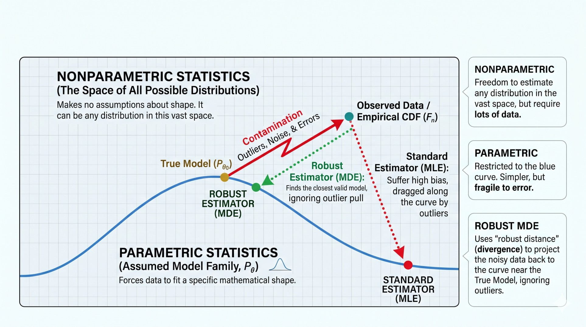{.nostretch .movielens-matrix}


## How to perform robust linear regression?
::: {.theorem}
**Density Power Divergence (DPD):** Given two density functions $f$ and $g$, [Basu et al. (1998)]{style="color: blue"} defines the DPD between them as 

$$
d_\alpha(g, f) = \begin{cases}
\displaystyle\int f^{1+\alpha} - \left(1+ \dfrac{1}{\alpha} \right)\displaystyle\int f^\alpha g + \dfrac{1}{\alpha} \displaystyle\int g^{1+\alpha}, & \alpha > 0\\
\displaystyle\int f \log(f / g) & \alpha = 0
\end{cases}
$$


:::


::: {.fragment data-fragment-index="0"}

Given an **independent but non-identically distributed** sample of observations $X_1, \dots X_n$ modelled by non-homogeneous families of densities $\{ f_{i,\theta}: \theta \in \Theta \}$, the **MDPDE** [(Ghosh and Basu)]{style="color: blue"} is defined as 

$$
\widehat{\theta}_\alpha = \arg\,\min_{\theta \in \Theta} \dfrac{1}{n}\sum_{i=1}^n \left[ \int f_{i, \theta}^{1+\alpha} - \left( 1 + \dfrac{1}{\alpha} \right) f_{i,\theta}^\alpha(X_i) \right]
$$

:::


## Robust SVD using DPD
For background modelling problem, usually $r = 1$, so we have 

$$
X_{ij} = a_i b_j + \epsilon_{ij}, \ \epsilon_{ij} \sim f(\cdot / \sigma), \sigma \in (0, \infty)
$$

 Assume form of $f$ is known and it is symmetric around $0$.


::: {.fragment data-fragment-index="0"}

- **Step 1:** Define weights, 

$$
w_{ij}^{(t)} = \psi\left( \vert X_{ij} - a_i^{(t)}b_{j}^{(t)} \vert / \sigma^{(t)}  \right), \ \psi(x) = -f^{\alpha-1}(\vert x\vert)f'(\vert x\vert) / \vert x\vert
$$

:::

::: {.fragment data-fragment-index="1"}

- **Step 2:** Update estimate of $a_i$ as 

$$
a_i^{(t+1/2)} = \left[ \sum_j \textcolor{brown}{(b_j^{(t)})^2 w_{ij}^{(t)}} \right]^{-1} \left[ \sum_j \textcolor{blue}{\dfrac{X_{ij} }{b_j^{(t)}}} \textcolor{brown}{(b_j^{(t)})^2 w_{ij}^{(t)}} \right], \ i = 1, \ldots n;
$$

:::

::: {.fragment data-fragment-index="2"}

- **Step 3:** Normalize the vector $a_i^{(t+1)} = a_i^{(t + 1/2)} / \Vert \boldsymbol{a}^{(t + 1/2)} \Vert$.

:::


## Robust SVD using DPD Algorithm (Continued)
- **Step 4:** Now fixing $\boldsymbol{a}^{(t+1/2)}$, update $b_i$ as 

    $$
    b_j^{(t+1)} = \left[ \sum_i \textcolor{brown}{(a_i^{(t+1)})^2 w_{ij}^{(t)}} \right]^{-1} \left[ \sum_i \textcolor{blue}{\dfrac{X_{ij}}{a_i^{(t+1)}}} \textcolor{brown}{(a_i^{(t+1)})^2 w_{ij}^{(t)} } \right], \ j = 1, \ldots p;
    $$

    

- **Step 5:** Normalize $\boldsymbol{b}^{(t+1)}$.


::: {.fragment data-fragment-index="0"}

- **Step 6:** Update noise variance 

    $$
    (\sigma^{(t+1)})^2 =
    \sum_{i,j} \textcolor{blue}{(x_{ij} - a_i^{(t+1)} b_j^{(t+1)})^2} \frac{w_{ij}^{(t)}}{np} / \left(\sum_{i,j} \frac{w_{ij}^{(t)}}{np} - \frac{\alpha}{(1 + \alpha)}\int f^{1+\alpha} \right)
    $$

    

- **Step 7:** Repeat until convergence.

:::


## Different choices of model family

::::: {.balanced-content}

::: {#tab:rpca-psi-and-g}
  **Density family**                 $\propto f(x)$                                               $\psi(x)$
  -------------------- ---------------------------- -------------------------------------------------------
  Normal                               $e^{-x^2/2}$                                     $e^{-\alpha x^2/2}$
  Laplace                       $e^{-\vert x\vert}$                  $e^{-\alpha\vert x\vert}/\vert x\vert$
  $t_\nu$                $(1+x^2/\nu)^{-(1+\nu)/2}$     $(1 + 1/\nu)(1 + x^2/\nu)^{-\alpha(\nu + 1)/2 - 1}$
  Logistic                    $e^{-x}/(1+e^{-x})^2$   $e^{-\alpha x}(1 - e^{-x})/x(1+e^{-x})^{2\alpha + 1}$

  : The choices of $\psi(\cdot)$ functions for different elliptically symmetric family of densities.
:::


::: {.fragment data-fragment-index="0"}

[Most of the cases, the $\psi(\cdot)$ is decreasing\
$\text{More errors} \implies \text{Less weight} \implies \text{More stable estimate}$]{style="color: blue"}

:::

:::::

## A bit of math to show it works! {.section-slide background-color="#2d5fb2"}


## Convergence Results
Assume that,

1.  $f$ is twice differentiable.

2.  $f'(x) \leq 0$ for all $x > 0$ and $\frac{1}{x} > \alpha \frac{f'(x)}{f(x)} + s'(x)\frac{f(x)}{f'(x)}$, where $s(x)$ is the score function. Equivalently, $\psi'(x) < 0$ for $x > 0$.

3.  $x^2 \psi(x) = O(1)$ for all $x \geq 0$.

::: {.theorem}
Under these assumptions,

1.  **Theorem 1** ([Roy, Basu and Ghosh, 2024]{style="color: blue"}) The algorithm converges to a global optimum of the restricted DPD objective function.

2.  **Theorem 2** ([Roy, Basu and Ghosh, 2024]{style="color: blue"}) The converged rPCAdpd estimator has orthogonal equivariance properties.
:::


## Identifiability Issue
[Can we always recover $\boldsymbol{L}$ and $\boldsymbol{S}$ from $\boldsymbol{X}$?]{style="color: blue"}


::: {.fragment data-fragment-index="0"}

[NO!]{style="color: red"}


$$
\boldsymbol{X} = \begin{bmatrix}
0 & 0 & 0\\
0 & 0 & 0\\
1 & 0 & 0\\
0 & 0 & 0
\end{bmatrix}
= \boldsymbol{L}_1 + \boldsymbol{S}_1 = \boldsymbol{L}_2 + \boldsymbol{S}_2
$$

 where 

$$
\boldsymbol{L}_1 = \boldsymbol{S}_2 = \boldsymbol{e}_3\boldsymbol{e}_1^\top, \
\boldsymbol{L}_2 = \boldsymbol{S}_1 = \boldsymbol{0}
$$

:::

::: {.fragment data-fragment-index="1"}

**Solution:** Assume 

$$
\begin{aligned}
\{ u_1(\boldsymbol{X}), \dots, u_r(\boldsymbol{X}) \} \cap \{ \boldsymbol{e}_1, \dots, \boldsymbol{e}_n \} & = \phi\\
\{ v_1(\boldsymbol{X}), \dots, v_r(\boldsymbol{X}) \} \cap \{ \boldsymbol{e}'_1, \dots, \boldsymbol{e}'_p \} & = \phi
\end{aligned}
$$

 [As a result, stereographic projection is possible!]{style="color: blue"}

:::

## Stereographic Projection

:::: {.columns}
::: {.column width="54%"}
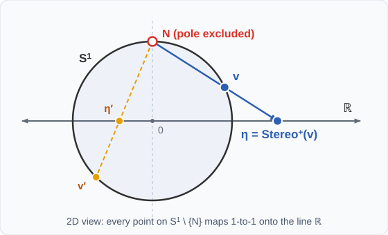{width="100%"}
:::

::: {.column width="46%"}
- **The catch:** A unit singular vector $\boldsymbol{v}_1$ ($\Vert \boldsymbol{v}_1 \Vert_2 = 1$) lives on the **curved** unit sphere $S^{p-1}$, not in flat Euclidean space.

- **2D intuition ($S^1 \to \mathbb{R}$):** Draw a straight ray from the north pole $\boldsymbol{N}$ through $\boldsymbol{v} \in S^1 \setminus \{\boldsymbol{N}\}$; its intersection with the horizontal line gives $\boldsymbol{\eta} = \text{Stereo}^+(\boldsymbol{v}) \in \mathbb{R}$.

- **Why it helps:** It smoothly flattens $S^{p-1} \setminus \{\boldsymbol{N}\}$ onto $\mathbb{R}^{p-1}$ (1-to-1), so $\hat{\boldsymbol{\eta}} = \text{Stereo}^+(\hat{\boldsymbol{v}}_1)$ obeys standard Euclidean asymptotic normality.
:::
::::


## Consistency and Asymptotic Normality


Assume that,

1.  The true error density $g$ is symmetric.

2.  $g$ satisfies $\int z^k e^{-\alpha z^2/2}g(z) = O(1)$ for $k = 0, 1, \dots, 4$.


::: {.theorem}
**Theorem:** ([Roy, Basu and Ghosh, 2024]{style="color: blue"}) For fixed $p$, as $n \rightarrow \infty$, the rSVDdpd estimates $\hat{\lambda}$ and $\hat{\boldsymbol{v}}_1$ and $\hat{\boldsymbol{\eta}} = \text{Stereo}^+(\hat{\boldsymbol{v}}_1)$ satisfies 

$$
\hat{\lambda} \xrightarrow{P} \lambda, \Vert \hat{\boldsymbol{v}}_1 - \boldsymbol{v}_1 \Vert_2 \xrightarrow{P} 0, \qquad
\sqrt{n} \begin{pmatrix}
\hat{\lambda} - \lambda\\
\hat{\boldsymbol{\eta}} - \boldsymbol{\eta}
\end{pmatrix} \xrightarrow{d} N(\boldsymbol{0}, \boldsymbol{V})
$$


:::


## Consistency for increasing dimension

::::: {.balanced-content}

In many situations, you will have $n, p \to \infty$ but $n/p \to \text{constant}$.

1.  Imagine spatiotemporal data, $n$ is the number of timepoints, $p$ is the number of locations.

2.  Connectivity matrix in network graph, $n = p \to \infty$, but $n / p = 1$.

::: {.theorem .fragment data-fragment-index="0"}
**Theorem** ([Roy, Ghosh and Basu, 2024]{style="color: blue"}) Under some regularity assumptions and when error variance $\sigma^2 \sim (np)^{-1/2}$, then as both $n \rightarrow \infty, p \rightarrow \infty$, but $n/p \rightarrow c \in (0, \infty)$, the rSVDdpd estimator converges to the true SVD estimates (i.e., the true minimum of DPD between $g$ and $f(\cdot / \sigma)$).
:::

:::::

## Simulation Results {.section-slide background-color="#2d5fb2"}

## Processing time per video frame

:::: {.timing-chart}

```{r}
#| label: frame-processing-time
#| echo: false
#| warning: false
#| message: false
#| dev: svglite
#| dev-args: {pointsize: 18}
#| fig-width: 12
#| fig-height: 4.6
#| out-width: "1200px"
#| fig-alt: "Mean processing time with plus or minus one standard deviation for eight methods, on a logarithmic seconds-per-frame axis. GRASTA is fastest at 0.37 seconds, followed by rSVDdpd at 2.86 seconds."

# Published Table 1, https://arxiv.org/pdf/2109.10680.
# These are reported benchmark summaries, not newly generated simulations.
timing <- data.frame(
    method = c("GRASTA", "rSVDdpd", "VB", "GoDec", "OP", "ALM", "SRPCP", "RPCA"),
    mean = c(0.37, 2.86, 7.06, 12.06, 23.42, 34.85, 54.25, 136.41),
    sd = c(0.01, 0.84, 1.39, 0.29, 0.22, 7.40, 9.12, 27.26)
)
y <- rev(seq_len(nrow(timing)))
colour <- ifelse(timing$method == "rSVDdpd", "#2d5fb2", "#616975")
par(mar = c(3.5, 5.1, 1.1, 7.8), mgp = c(2.3, 0.7, 0), las = 1)
plot(timing$mean, y,
    log = "x", xlim = c(0.25, 190), ylim = c(0.6, 8.5),
    type = "n", axes = FALSE, xlab = "Processing time (seconds/frame, logarithmic scale)",
    ylab = "", bty = "n"
)
ticks <- c(0.3, 1, 3, 10, 30, 100)
abline(v = ticks, col = "#e4e7eb", lwd = 1)
axis(1, at = ticks, labels = ticks, col = "#8b929a")
axis(2, at = y, labels = timing$method, tick = FALSE, col.axis = "#303030")
arrows(timing$mean - timing$sd, y, timing$mean + timing$sd, y,
    angle = 90, code = 3, length = 0.045, col = colour, lwd = 2
)
points(timing$mean, y, pch = 19, cex = 1.15, col = colour)
text(230, y, sprintf("%.2f ± %.2f", timing$mean, timing$sd),
    adj = 0, xpd = NA, cex = 0.85, col = colour
)
text(230, 8.65, "Mean ± SD", adj = 0, xpd = NA, cex = 0.85, font = 2)
```

::::

**rSVDdpd is the second fastest method in this reported benchmark.**

::: {.source-note}
Points: reported means. Error bars: ±1 standard deviation (not confidence intervals). Lower is faster. Source: [Roy, Basu and Ghosh, Table 1, arXiv:2109.10680](https://arxiv.org/pdf/2109.10680).
:::

::: {.notes}
This is the published background-modelling timing benchmark, not a fresh simulation run. The horizontal axis is logarithmic to show all eight methods, whose mean times range from 0.37 to 136.41 seconds/frame. Error-bar endpoints are the reported arithmetic mean minus/plus one reported standard deviation, placed on the logarithmic axis. Runtime comparisons apply to the experimental setting in the paper and do not establish real-time performance on current hardware.
:::

## Street Video benchmark: F1 scores

:::: {.f1-chart}

```{r}
#| label: street-video-f1
#| echo: false
#| warning: false
#| message: false
#| dev: svglite
#| dev-args: {pointsize: 18}
#| fig-width: 12.8
#| fig-height: 5
#| out-width: "1280px"
#| fig-alt: "F1 scores for eight methods across ten Street Video variants. Orange borders and bold values mark each column's best reported score, including ties. rSVDdpd leads in eight columns, with two ties."

# Reported F1 rows from Table 2; retain the published three-decimal values.
# No replicate-level data are supplied, so no uncertainty bars are inferred.
f1 <- rbind(
    RPCA = c(0.767, 0.754, 0.767, 0.754, 0.725, 0.728, 0.787, 0.726, 0.592, 0.489),
    ALM = c(0.767, 0.754, 0.768, 0.755, 0.725, 0.729, 0.787, 0.726, 0.595, 0.488),
    SRPCP = c(0.767, 0.754, 0.768, 0.755, 0.725, 0.729, 0.788, 0.726, 0.595, 0.488),
    VB = c(0.770, 0.757, 0.767, 0.754, 0.725, 0.728, 0.786, 0.709, 0.386, 0.405),
    OP = c(0.776, 0.762, 0.773, 0.757, 0.727, 0.650, 0.785, 0.712, 0.641, 0.553),
    GoDec = c(0.757, 0.733, 0.767, 0.754, 0.724, 0.672, 0.785, 0.474, 0.263, 0.282),
    GRASTA = c(0.700, 0.699, 0.665, 0.734, 0.680, 0.428, 0.785, 0.176, 0.364, 0.371),
    rSVDdpd = c(0.777, 0.772, 0.774, 0.757, 0.725, 0.754, 0.787, 0.766, 0.681, 0.553)
)
colnames(f1) <- c("V111", "V112", "V211", "V212", "V311", "V312", "V411", "V412", "V511", "V512")
best <- abs(sweep(f1, 2, apply(f1, 2, max), "-")) < 1e-12
stopifnot(
    all(f1 >= 0 & f1 <= 1), sum(best["rSVDdpd", ]) == 8,
    sum(best["rSVDdpd", ] & colSums(best) > 1) == 2
)
palette <- colorRampPalette(c("#f7fbff", "#c6dbef", "#6baed6", "#2171b5", "#08306b"))(101)
par(mar = c(0.6, 5.2, 2.3, 0.7), xaxs = "i", yaxs = "i", las = 1)
plot.new()
plot.window(xlim = c(0.5, 11.9), ylim = c(0.5, 8.5))
axis(3, at = 1:10, labels = colnames(f1), tick = FALSE, line = -0.3, cex.axis = 0.85)
for (i in seq_len(nrow(f1))) {
    y <- 9 - i
    label_colour <- if (rownames(f1)[i] == "rSVDdpd") "#2d5fb2" else "#303030"
    text(0.35, y, rownames(f1)[i],
        adj = 1, xpd = NA, col = label_colour,
        font = if (rownames(f1)[i] == "rSVDdpd") 2 else 1, cex = 0.9
    )
    for (j in seq_len(ncol(f1))) {
        value <- f1[i, j]
        rect(j - 0.5, y - 0.5, j + 0.5, y + 0.5,
            col = palette[round(value * 100) + 1], border = "white"
        )
        if (best[i, j]) {
            rect(j - 0.47, y - 0.47, j + 0.47, y + 0.47,
                border = "#e69f00", lwd = 2.5
            )
        }
        text(j, y, sprintf("%.3f", value),
            cex = 0.87,
            col = if (value >= 0.6) "white" else "#17212c",
            font = if (best[i, j]) 2 else 1
        )
    }
}
# A fixed 0-to-1 color scale keeps differences in perspective.
for (k in 0:99) {
    rect(10.9, 1 + k * 0.06, 11.15, 1 + (k + 1) * 0.06,
        col = palette[k + 1], border = NA
    )
}
text(11.025, 7.65, "F1", font = 2, cex = 0.9)
text(11.3, 1 + c(0, 0.5, 1) * 6, c("0", "0.5", "1"), adj = 0, cex = 0.8)
```

::::

**rSVDdpd has the highest reported F1 in 8 of 10 columns, including 2 ties.**

::: {.source-note}
Higher is better. Orange borders and bold values mark column maxima, including ties at the reported precision. In $V_{i1j}$, $i$ identifies the variant and $j=1,2$ denotes training/testing. Source: [Roy, Basu and Ghosh, Table 2, arXiv:2109.10680](https://arxiv.org/pdf/2109.10680).
:::

::: {.notes}
These are the published F1 values supplied in Table 2, not results from a new simulation. Comparisons use the reported three-decimal scores and do not establish statistical significance. rSVDdpd is the sole maximum for V111, V112, V211, V312, V412, and V511; it ties with OP for V212 and V512. OP leads for V311, and SRPCP leads for V411. Precision and recall remain in the source table; this slide compares F1 only.
:::

## Robust PCA: simulation scenario S2b

**20% contamination**, with dimension $p=10,25,50,100,250$.

:::: {.pca-chart}

```{r}
#| label: robust-pca-s2b
#| echo: false
#| warning: false
#| message: false
#| dev: svglite
#| dev-args: {pointsize: 18}
#| fig-width: 13.2
#| fig-height: 5.2
#| out-width: "1320px"
#| fig-alt: "Three panels compare Bias, MAE and SRE across five dimensions for all twelve PCA methods in scenario S2b. The four DPD curves are blue. DPD with alpha equal to one has the lowest reported Bias and MAE at every dimension. Missing RobCov results at p at least fifty are not interpolated."

# Published Table 3, Roy, Basu and Ghosh (2024), JMLR.
# Columns follow the supplied table; NA denotes an unreported result.
p_dimension <- c(10, 25, 50, 100, 250)
pca_methods <- c(
    "Classical", "LOC", "ROBPCA", "Proj", "RobCov", "Grid",
    "Gmed", "PCP", "DPD (0.25)", "DPD (0.5)", "DPD (0.75)", "DPD (1)"
)
pca_results <- list(
    Bias = matrix(c(
        0.321, 0.757, 0.381, 0.429, 0.589, 0.757, 0.140, 1.065, 0.329, 0.281, 0.138, 0.067,
        0.553, 2.198, 0.368, 0.635, 1.004, 1.344, 0.235, 2.451, 0.568, 0.364, 0.073, 0.036,
        1.467, 4.602, 0.829, 1.796, NA, 3.221, 0.583, 4.617, 1.480, 0.970, 0.323, 0.182,
        2.660, 9.414, 1.028, 2.692, NA, 6.019, 1.235, 9.159, 2.766, 2.005, 0.533, 0.200,
        7.033, 23.805, 3.245, 8.006, NA, 15.969, 2.746, 22.799, 7.089, 4.447, 1.446, 0.299
    ), nrow = 5, byrow = TRUE),
    MAE = matrix(c(
        41.990, 75.693, 43.080, 52.712, 60.646, 82.448, 30.185, 106.511, 45.196, 42.803, 29.261, 22.409,
        85.197, 219.781, 63.246, 93.376, 112.498, 165.495, 65.545, 245.114, 90.830, 74.713, 45.453, 41.413,
        194.589, 460.223, 130.581, 236.929, NA, 406.956, 144.635, 462.199, 209.841, 172.386, 110.373, 96.321,
        364.678, 941.397, 221.517, 400.614, NA, 665.195, 267.786, 916.897, 394.475, 317.498, 173.981, 142.885,
        957.207, 2380.505, 518.404, 1066.532, NA, 1696.499, 658.650, 2283.607, 1060.277, 838.361, 545.850, 432.927
    ), nrow = 5, byrow = TRUE),
    SRE = matrix(c(
        1.812, 2.049, 1.109, 2.346, 1.424, 2.886, 1.889, 1.197, 1.811, 1.774, 1.405, 1.111,
        2.140, 2.422, 1.021, 2.645, 2.212, 4.190, 2.260, 1.276, 2.152, 1.832, 1.111, 1.030,
        2.219, 2.472, 1.020, 2.828, NA, 4.985, 2.314, 2.265, 2.240, 1.819, 1.201, 1.049,
        2.227, 2.453, 1.043, 2.868, NA, 3.860, 2.326, 2.272, 2.242, 1.868, 1.153, 1.007,
        2.249, 2.549, 1.066, 2.976, NA, 3.901, 2.362, 2.302, 2.262, 1.767, 1.160, 1.007
    ), nrow = 5, byrow = TRUE)
)
# Check the missing entries and the slide's descriptive takeaway.
stopifnot(
    all(vapply(pca_results, function(x) {
        sum(is.na(x)) == 3 &&
            all(is.na(x[3:5, 5]))
    }, logical(1))),
    all(apply(pca_results$Bias, 1, which.min) == 12),
    all(apply(pca_results$MAE, 1, which.min) == 12)
)
pca_colours <- c(
    "#333333", "#999999", "#d55e00", "#888888", "#bbbbbb", "#777777",
    "#009e73", "#aaaaaa", "#91b9de", "#5695c9", "#2166ac", "#08306b"
)
pca_lty <- c(1, 2, 1, 3, 4, 5, 1, 6, 4, 3, 2, 1)
pca_pch <- c(1, 2, 17, 3, 4, 5, 15, 6, 0, 2, 5, 16)
pca_lwd <- c(1.2, 1.2, 2, 1.2, 1.2, 1.2, 2, 1.2, 2, 2, 2.5, 3)
layout(rbind(c(1, 2, 3), c(4, 4, 4)), heights = c(4, 1.2))
par(mar = c(3.1, 3.1, 2.2, 0.8), mgp = c(1.9, 0.6, 0), las = 1)
for (metric in names(pca_results)) {
    matplot(p_dimension, pca_results[[metric]],
        type = "b",
        log = if (metric == "SRE") "x" else "xy", xaxt = "n",
        col = pca_colours, lty = pca_lty, pch = pca_pch, lwd = pca_lwd,
        cex = 0.65, cex.axis = 0.78, bty = "l", xlab = "Dimension p", ylab = "",
        main = paste0(metric, if (metric == "SRE") " (linear)" else " (log scale)"),
        cex.main = 1
    )
    axis(1, at = p_dimension, labels = p_dimension, cex.axis = 0.78)
}
par(mar = c(0, 0, 0, 0))
plot.new()
legend("center",
    legend = pca_methods, ncol = 4, bty = "n", cex = 0.83,
    col = pca_colours, lty = pca_lty, pch = pca_pch, lwd = pca_lwd,
    x.intersp = 0.65, y.intersp = 1.05
)
```

::::

**DPD ($\alpha=1$) has the lowest reported Bias and MAE at every dimension.**

::: {.source-note}
Lower is better for all metrics. Bias/MAE use log scales; SRE uses a linear scale. All panels use a log-scaled $p$ axis. RobCov has no reported results for $p\geq50$. Source: [Roy, Basu and Ghosh (2024), JMLR, Table 3 (S2b)](https://jmlr.org/papers/volume25/23-1096/23-1096.pdf).
:::

::: {.notes}
These are published simulation summaries, not a new simulation run. All 12 methods and all 180 table entries are retained in the source, including the nine NA entries. The four DPD series correspond to robustness tuning parameters alpha = 0.25, 0.5, 0.75 and 1. Scenario S2b uses contamination probability 0.2 with f1 = 3 and f2 = 1. ROBPCA has the lowest reported SRE at p = 10, 25 and 50, while DPD (1) has the lowest SRE at p = 100 and 250. No replicate-level uncertainty is available in the supplied table, so no confidence intervals or significance claims are inferred. Connecting lines guide comparisons across dimensions.
:::

## Putting it to use! {.section-slide background-color="#2d5fb2"}


## Background Modelling
**Dataset:** University of Houston Camera Tampering Dataset.


:::: {.columns}

::: {.column width="20%"}
**Truth**


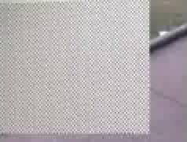
:::

::: {.column width="20%"}
**OP**


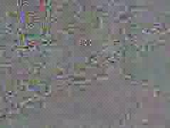


:::

::: {.column width="20%"}
**ADMM**


:::

::: {.column width="20%"}
**GoDec**


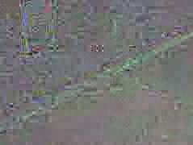

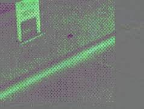
:::

::: {.column width="20%"}
**rSVDdpd**


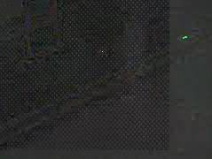


:::

::::

Rows: frames 5, 50, and 75. The last four columns show estimated foreground.


## Video comparison
```{=html}
<div class="video-comparison">
<figure><figcaption>Original footage</figcaption><video controls muted playsinline preload="metadata" data-ignore src="vids/video512-true.mp4"></video></figure>
<figure><figcaption>SVD</figcaption><video controls muted playsinline preload="metadata" data-ignore src="vids/svd-512.mp4"></video></figure>
<figure><figcaption>rSVDdpd</figcaption><video controls muted playsinline preload="metadata" data-ignore src="vids/rsvddpd-512.mp4"></video></figure>
</div>
<div class="video-controls">
<button type="button" data-video-action="play">Play all</button>
<button type="button" data-video-action="pause">Pause all</button>
<button type="button" data-video-action="restart">Restart all</button>
<span class="video-status" role="status"></span>
</div>
```


## Recommender Systems: Filling in the Blanks
- MovieLens 100k, restricted to $50$ active users $\times$ $120$ popular movies ($75\%$ observed).

- Rows/columns sorted by their loading on the first robust factor -- the same sort reveals a smooth gradient in *both* panels.

::: center
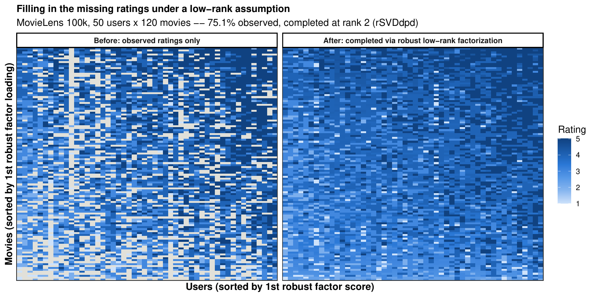{.nostretch .completion-matrix}
:::


## Recommender Systems: Are the Factors Meaningful?
A numerically low rank is useful if recovered factors correspond to something real. Look at the movies loading most heavily on each robust singular vector.


:::: {.columns}

::: {.column width="50%"}
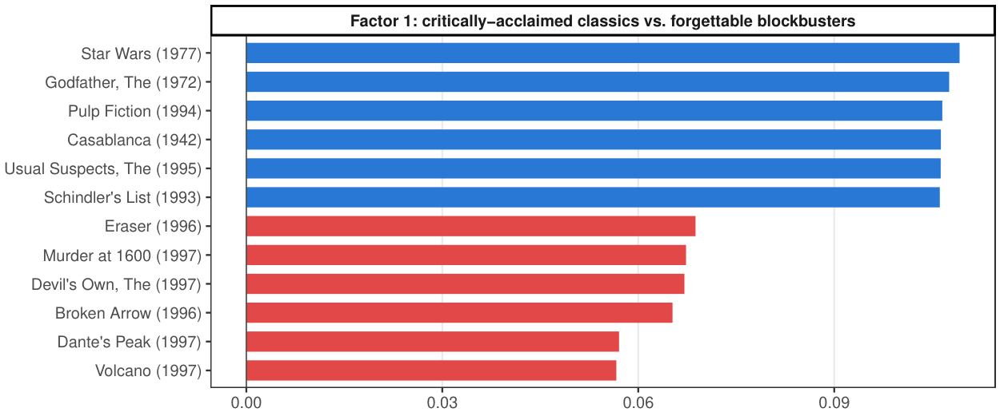

Separates critically acclaimed classics (*Godfather*, *Pulp Fiction*, *Casablanca*) from mid-90s blockbusters (*Volcano*, *Dante's Peak*).
:::

::: {.column width="50%"}
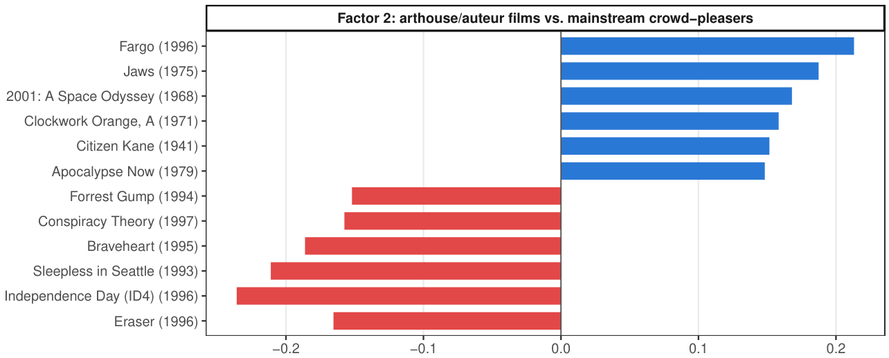

Separates arthouse/auteur films (*Fargo*, *2001: A Space Odyssey*, *Citizen Kane*) from mainstream crowd-pleasers (*Independence Day*, *Forrest Gump*).
:::

::::


## Conclusion

<!-- ::::: {.balanced-content .conclusion-content} -->

- **Robust low-rank estimation:** alternating regression with DPD downweights large residuals when estimating the latent structure.

- **Applications:** background/foreground separation in video and latent-factor recovery in recommender systems.

- **Theory:** convergence, equivariance and consistency results hold under the stated assumptions.

- **Computation:** The iterative robust SVD algorithm is extremely fast, parallelizable, and is simply a weighted regression computation.

<!-- ::::: -->

[**`rsvddpd` on CRAN**](https://cran.r-project.org/package=rsvddpd) implements the **`rSVDdpd()`** estimator.

```{r}
#| eval: false
#| echo: true
install.packages("rsvddpd")
library(rsvddpd)
fit <- rSVDdpd(X, alpha = 0.5) # X is the data matrix
```

::: {.paper-references}

**Roy, Ghosh and Basu (2024).** [Robust singular value decomposition with application to video surveillance background modelling](https://link.springer.com/article/10.1007/s11222-024-10493-7). *Statistics and Computing*, **34**, 178.

**Roy, Basu and Ghosh (2024).** [Robust Principal Component Analysis using Density Power Divergence](https://jmlr.org/papers/volume25/23-1096/23-1096.pdf). *Journal of Machine Learning Research*, **25**(324), 1–40.

:::

## Future Directions

Extending DPD-based robust low-rank estimation beyond standard i.i.d. numerical matrices:

:::: {.future-grid}

::: {.future-card}
```{=html}
<div class="future-visual">
  <svg viewBox="0 0 220 120" width="210" height="115" aria-hidden="true">
    <polygon points="35,42 95,42 118,22 58,22" fill="#dbeafe" stroke="#2d5fb2" stroke-width="2"/>
    <polygon points="95,42 118,22 118,76 95,96" fill="#bfdbfe" stroke="#2d5fb2" stroke-width="2"/>
    <rect x="35" y="42" width="60" height="54" fill="#eff6ff" stroke="#2d5fb2" stroke-width="2"/>
    <line x1="55" y1="42" x2="55" y2="96" stroke="#93c5fd" stroke-width="1.2"/>
    <line x1="75" y1="42" x2="75" y2="96" stroke="#93c5fd" stroke-width="1.2"/>
    <line x1="35" y1="60" x2="95" y2="60" stroke="#93c5fd" stroke-width="1.2"/>
    <line x1="35" y1="78" x2="95" y2="78" stroke="#93c5fd" stroke-width="1.2"/>
    <text x="65" y="73" font-size="15" font-weight="700" fill="#174d78" text-anchor="middle">&#x1d4e7;</text>
    <line x1="128" y1="59" x2="152" y2="59" stroke="#616975" stroke-width="2"/>
    <polygon points="150,54 159,59 150,64" fill="#616975"/>
    <rect x="166" y="26" width="12" height="58" rx="2" fill="#2d5fb2" opacity="0.85"/>
    <rect x="184" y="44" width="12" height="40" rx="2" fill="#2d5fb2" opacity="0.65"/>
    <polygon points="166,94 196,94 206,84 176,84" fill="#2d5fb2" opacity="0.45"/>
    <text x="184" y="110" font-size="11" fill="#475569" text-anchor="middle">CP / Tucker</text>
  </svg>
</div>
```

### 1. Higher-Order Tensors

Generalize alternating DPD regression from matrices to $k$-way tensors (e.g., robust CP and Tucker decompositions) to preserve multi-way structure.

::: {.future-apps}
**Applications:** Multi-channel (RGB) video, neuroimaging (fMRI), longitudinal economic panels.
:::
:::

::: {.future-card .card-glm}
```{=html}
<div class="future-visual">
  <svg viewBox="0 0 220 120" width="210" height="115" aria-hidden="true">
    <rect x="20" y="24" width="76" height="72" rx="4" fill="#f0fdf4" stroke="#44845b" stroke-width="2"/>
    <g font-size="12" font-weight="700" fill="#166534" text-anchor="middle">
      <text x="34" y="43">1</text><text x="58" y="43">0</text><text x="82" y="43">3</text>
      <text x="34" y="65">0</text><text x="58" y="65">1</text><text x="82" y="65">0</text>
      <text x="34" y="87">2</text><text x="58" y="87">0</text><text x="82" y="87">1</text>
    </g>
    <line x1="104" y1="60" x2="134" y2="60" stroke="#616975" stroke-width="2"/>
    <polygon points="132,55 141,60 132,65" fill="#616975"/>
    <text x="122" y="50" font-size="11" font-style="italic" fill="#475569" text-anchor="middle">g(&#x03bc;)</text>
    <path d="M 148 86 Q 170 30, 204 34" fill="none" stroke="#44845b" stroke-width="3"/>
    <circle cx="160" cy="64" r="3.5" fill="#44845b"/>
    <circle cx="176" cy="45" r="3.5" fill="#44845b"/>
    <circle cx="195" cy="36" r="3.5" fill="#44845b"/>
    <text x="176" y="104" font-size="11" fill="#475569" text-anchor="middle">a&#x1d62;&#x1d40;b&#x2c7c; (low rank)</text>
  </svg>
</div>
```

### 2. Generalized Linear Models

Extend theory and DPD weights to exponential-family observations via $g(\mathbb{E}[X_{ij}]) = \boldsymbol{a}_i^\top \boldsymbol{b}_j$ for non-Gaussian data.

::: {.future-apps}
**Applications:** Binary/weighted networks, count matrices, sparse click & purchase logs.
:::
:::

::: {.future-card .card-dep}
```{=html}
<div class="future-visual">
  <svg viewBox="0 0 220 120" width="210" height="115" aria-hidden="true">
    <line x1="22" y1="88" x2="200" y2="88" stroke="#94a3b8" stroke-width="1.5"/>
    <line x1="22" y1="22" x2="22" y2="88" stroke="#94a3b8" stroke-width="1.5"/>
    <path d="M 26 68 C 44 34, 62 34, 80 62 C 98 86, 116 30, 138 48 C 156 64, 174 32, 194 50" fill="none" stroke="#e69f00" stroke-width="2.5"/>
    <circle cx="116" cy="24" r="4" fill="#d93025"/>
    <line x1="116" y1="28" x2="116" y2="44" stroke="#d93025" stroke-width="1.5" stroke-dasharray="2 2"/>
    <path d="M 46 94 Q 63 106, 80 94" fill="none" stroke="#b45309" stroke-width="1.5"/>
    <path d="M 80 94 Q 100 106, 120 94" fill="none" stroke="#b45309" stroke-width="1.5"/>
    <text x="110" y="114" font-size="11" fill="#475569" text-anchor="middle">Cov(&#x03b5;&#x1d62;&#x2c7c;, &#x03b5;&#x2097;&#x2098;) &#x2260; 0</text>
  </svg>
</div>
```

### 3. Non-i.i.d. Dependence

Relax the independence assumption on $\epsilon_{ij}$ to establish consistency and inference under spatial and temporal correlation.

::: {.future-apps}
**Applications:** Dynamic/rippling backgrounds, climate fields, time-evolving graphs.
:::
:::

::::


## Thank you for listening {.thank-you-slide background-color="#2d5fb2"}

Questions?

[roy.s@wustl.edu](mailto:roy.s@wustl.edu)
